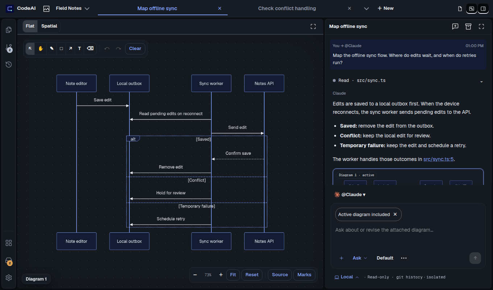
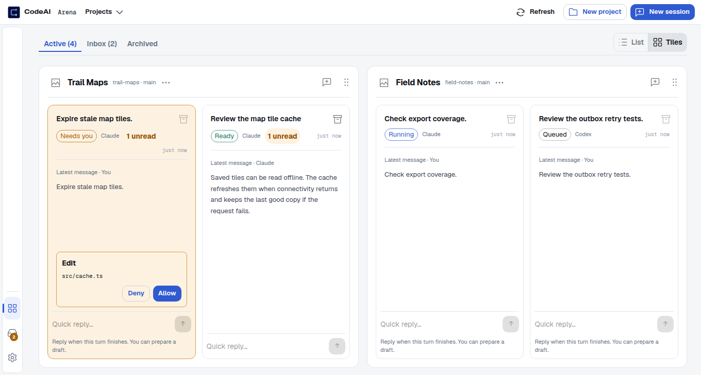

# CodeAI

**A local-first workspace for coding with Claude Code and Codex.** Keep agent sessions across
projects in one Arena, then open a session to work with its conversation, source files, Git diffs
and an interactive Mermaid canvas.

[Quick start](#quick-start) · [What you can do](#what-you-can-do) · [Current state](#current-state) ·
[Roadmap](#roadmap) · [User guide](docs/user-guide.md)



*Ask an agent to map a code path, then open its Mermaid diagram beside the conversation. Sample project shown.*

## What you can do

- **Track work across projects.** The Arena shows active and queued sessions and flags work that
  needs your attention. Reply or review approvals from the overview, and archive or restore sessions
  as work moves on.
- **Work with Claude Code and Codex in one conversation.** Start with either CLI. Add a reviewer,
  tester or another coding participant and choose who gets the next message. Each agent keeps its
  own provider history and receives relevant conversation context when you hand off work.
- **Explore code visually.** Ask for a Mermaid diagram, annotate it, and attach the marked view to
  a follow-up. Open repository files from chat links or fuzzy search, and review code and diffs
  alongside the conversation.
- **Review and control changes.** Start in read-only Ask or Plan mode, then choose a writing mode
  when you’re ready. Use a separate Git worktree for parallel changes, inspect diffs, stage files,
  commit the reviewed index, and use checkpoint Undo for eligible checkout edits.



*The Arena groups sessions by project and brings recent replies, quick replies and approvals into one view.*

## Quick start

You’ll need **Node.js 22.12+ and npm 10.5.1+** for the bundled toolchain, a trusted local Git
repository, and at least one installed and signed-in CLI, `claude` or `codex`. The CLI’s usual
login and billing apply.

```sh
git clone https://github.com/dmitry-yudakov/code-vis.git
cd code-vis
npm ci
cp .env.example .env.local
```

Set `CODEAI_REPOSITORIES_ROOT` in `.env.local` to the absolute path of your repository or a directory
containing your repositories. Then start CodeAI.

```sh
npm run dev -- --hostname 127.0.0.1
```

Open <http://localhost:3023/arena>. Choose **New project**, select a repository, then choose
**New session** in that project. Select **Ask** and **Create and open**. Try asking “Map how an
incoming request reaches storage. Include a Mermaid diagram.” On the diagram card, select
**Open on canvas**.

For a production build, run `npm run build` followed by `npm start -- --hostname 127.0.0.1`.

## Current state

CodeAI is under active development, with a working desktop browser workflow for a single operator.
Projects, conversations and canvases are saved on the machine that owns them. The selected CLI handles
model requests using its own configuration and credentials.

- **Execution.** Local agents are the default. Ask and Plan are read-only. Writing modes act on
  the selected checkout, with approvals and sandbox behavior determined by the provider and
  machine policy. Managed worktree creation and checkpoint Undo currently require Linux. See the
  [safety model](docs/user-guide.md#safety-model).
- **Devices and machines.** Pair a phone, tablet or other personal device over trusted HTTPS to
  reach the same workspace. Attach another execution machine to view and manage its sessions from
  your Arena. See [device setup](docs/user-guide.md#personal-devices) and
  [execution machines](docs/user-guide.md#execution-machines).
- **Optional integrations.** The built-in Observer can brief you across sessions and help you send
  confirmed follow-ups. Scoped MCP grants let an external agent host read the serving machine’s
  sessions and request selected actions. Docker execution is opt-in. Physical phone voice,
  external model-host and Docker release verification are still tracked in the corresponding
  [Observer story](stories/STORY-20261117-global-observer.md),
  [MCP story](stories/STORY-20261120-mcp-external-observer.md) and
  [Docker guide](docs/docker-execution.md).
- **Spatial and VR.** Explore diagrams in a desktop 3D view or a paired WebXR headset. A core
  controller-and-voice workflow was accepted on Quest 3S. Broader headset checks remain in the
  [immersive workspace epic](stories/EPIC-20260905-immersive-workspace.md).

## Roadmap

- **Give each repository a lasting software map.** Today an opt-in `/model` turn can collect
  temporary, agent-suggested facts. The next model milestone is a durable per-checkout record that
  updates as code changes, followed by focused Mermaid views built from that record.
  [Development queue](docs/development-queue.md#q5-persistent-repository-model) ·
  [Software model roadmap](stories/EPIC-20260705-north-star-roadmap.md)
- **Make the map useful for reviewing changes.** Future work includes combining agent suggestions
  with facts from a static analyzer, showing proposed changes on the map, and saving focused views
  with notes. [Software model vision](docs/software-model.md)
- **Make handoffs easier to follow.** A planned CodeAI-managed reviewer/coder workflow would link
  sessions, retain findings and corrections, and give the user control over retries and stopping.
  [Workflow proposal](stories/STORY-20261120-mcp-external-observer.md#native-codeai-reviewercoder-workflows--follow-up)

## Documentation

- [User guide](docs/user-guide.md) for setup, permissions, Git, the canvas and troubleshooting.
- [MCP setup and tool reference](docs/mcp.md) for connecting an external agent host.
- [Product vision](docs/vision.md) and [development queue](docs/development-queue.md) for direction and status.
- [Architecture](docs/architecture.md) and [repository conventions](AGENTS.md) for contributors.
