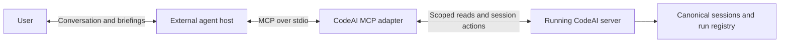

# Story 151 — Expose projects and session management to an external Observer through MCP

**Status:** In progress · **Type:** Full-stack · **Depends on:** [Story 129](STORY-20261106-workspace-subscriptions.md), [Story 135](STORY-20261107-queue-project-sessions.md), [Story 147](STORY-20261117-global-observer.md), [Story 148](STORY-20261118-observer-session-actions.md), [Story 149](STORY-20261118-restart-session-continuity.md), [Story 150](STORY-20261118-participant-controls.md)

## Motivation

CodeAI should expose projects, session facts and session management while an external agent owns
the Observer's reasoning, monitoring policy and conversation with the user. The agent can discover
all projects and active sessions, archive a session, and create work in the current checkout or a
new worktree, starting it normally or using the existing session queue. It can also add another
provider to a session and address individual participants for implementation, review and corrections.
This advances
[the Arena's orchestration goal](../docs/vision.md#thesis). In the repository vocabulary, sessions
belong to a **machine**; a phone or browser **device** watches that machine. This first slice
exposes sessions owned by the serving machine, including its Local and Docker sessions.

The proposed delivery includes observation, session creation/archiving, participant additions and
addressed messages through the external agent's own host. Replacing the in-app Observer and native
reviewer/coder orchestration are follow-ups below. The MCP bridge, stdio adapter and external monitoring example are implemented; real external-host
acceptance remains pending approval.

## Current behavior (where the code is)

- [observerService.ts:74](../src/server/observer/observerService.ts#L74) runs a fresh, tool-free,
  deadline-limited inference for each question. It reads the aggregated Arena feed and can read
  one bounded recent transcript. It does not run an autonomous monitoring loop.
- [workspaceFeed.ts:114](../src/server/workspace/workspaceFeed.ts#L114) owns shared local/executor
  subscriptions, run and storage invalidation, and teardown. Its `executor` feed contains only
  the serving machine; its `arena` feed also subscribes to attached machines.
- [localExecutorSnapshot.ts:12](../src/server/machines/localExecutorSnapshot.ts#L12) builds local
  summaries and run attention without traversing attached machines.
- [projects/route.ts:11](../src/app/api/projects/route.ts#L11) lists all stored projects, including
  projects without sessions or repositories.
- [sessionCreation.ts:9](../src/server/conversation/sessionCreation.ts#L9) owns current-checkout and
  managed-worktree creation; [creationRequests.ts:45](../src/server/storage/creationRequests.ts#L45)
  replays durable creation identities across active and archived sessions.
- [submitMessage.ts:43](../src/server/conversation/submitMessage.ts#L43) accepts and persists turns
  through the existing scheduler. [sessionQueue.ts:7](../src/server/runs/sessionQueue.ts#L7) finds
  earlier conversations whose archival releases a queued session.
- [participants/route.ts:29](../src/app/api/sessions/[sessionId]/participants/route.ts#L29) validates
  participant additions; [sessionStore.ts:1003](../src/server/storage/sessionStore.ts#L1003) owns
  retry-idempotent additions, stable ids, role defaults and the eight-agent roster limit.
- [transcript.ts:128](../src/server/conversation/transcript.ts#L128) supplies the addressed agent's
  missed canonical conversation as bounded authored data, retaining each participant's own cursor.
  [Story 150](STORY-20261118-participant-controls.md) keeps recipient selection, drafts and roster
  additions separate; [Story 23](STORY-20260817-web2-multi-agent-roles.md) owns manual handoff semantics.
- [archive/route.ts:17](../src/app/api/sessions/[sessionId]/archive/route.ts#L17) checks the expected
  revision and live-run exclusion, holds archive admission, then notifies the queue after saving.
- [sessionStore.ts:213](../src/server/storage/sessionStore.ts#L213) produces public session records;
  [sessionStore.ts:226](../src/server/storage/sessionStore.ts#L226) produces summary projections.
  Provider continuation state belongs to private records and is not integration context.
- [deviceAuthorization.ts:131](../src/server/devices/deviceAuthorization.ts#L131) authorizes browser
  access; machine bearers have a separate route allowlist. Neither credential is an MCP grant.
- [observer.ts:4](../src/shared/observer.ts#L4) defines target and proposal identities.
  [observerActions.ts:45](../src/features/observer/observerActions.ts#L45) loads canonical action
  previews and rechecks pinned run/request identities before acting.
- [observerDelivery.ts:58](../src/features/observer/observerDelivery.ts#L58) preserves immutable
  follow-up identities and reconciles acceptance after an uncertain response.

Before this story there was no CodeAI MCP server or MCP SDK dependency. Native writing sessions can already
load integrations from the user's provider setup; Guarded and Ask/Plan isolation remains a
separate contract. [Reserved Story 11](EPIC-20260705-north-star-roadmap.md#phase-a--re-found-the-model-on-the-running-product-now)
concerns software-model queries and write-back, which can later share this transport.

## Desired behavior

### Ownership and connection

1. Provide a local stdio MCP entry point, `npm run mcp`, using the official TypeScript SDK.
   Publish a copyable client configuration using the absolute Node/script paths so package-manager
   output cannot corrupt protocol stdout. Diagnostics go to stderr. Setup does not edit provider
   configuration or start an agent automatically.
2. The entry point is a thin client of the **running** application's integration bridge. Add
   `/api/integrations/mcp` for a strict allowlist of operations and its workspace subscription.
   This internal HTTP/NDJSON bridge is not a public MCP HTTP transport. Server modules own reads
   and subscriptions; the CLI must not instantiate another scheduler, open session storage,
   invoke providers or start a second application server.
3. Provision and revoke a named integration grant through local CLI commands. The adapter's
   private connection file lives outside checkouts under the installation data directory with
   owner-only permissions. It records the exact server origin, machine identity and credential;
   the server stores a credential digest. Default grants have `projects:read` and `sessions:read`;
   mutations require explicitly granting the needed `sessions:create`, `sessions:archive`,
   `participants:add` and/or `messages:send` scopes. Participant creation and message sending are
   separate capabilities. `sessions:create` includes its bound initial run/queue message; it does
   not authorize participant additions or separate messages to existing sessions. Every call to
   `send_message`, including a first message to an existing empty session, requires `messages:send`.
   Advertise only tools available to that grant and enforce scopes again at dispatch. Raw
   credentials never appear in repository configuration, URLs, logs, model context or copied
   client examples.
4. The bridge always requires that grant, including ordinary local development. Browser cookies
   and attached-machine bearers do not authenticate it, and its credential authorizes no ordinary
   device, machine or mutation route. Existing unauthenticated local access keeps its current
   contract; grant isolation is not a sandbox for the external agent's other tools.
   Paired installations retain the existing trusted HTTPS transport; local HTTP is restricted to
   a configured loopback origin. Reject redirects, wrong
   Host/Origin values and a changed machine identity; never disable certificate verification.
5. Recheck grant validity on operations, immediately before mutations, and on subscription
   heartbeats at the existing five-second cadence. Revocation closes active subscriptions by the
   next heartbeat and prevents later mutations; it does not undo a created session or cancel an
   accepted turn. Reconnect never renews a revoked grant. Missing setup or a stopped server yields
   an actionable error.

Use the SDK's supported protocol versions and document the versions actually verified with the
chosen clients. Resource subscription methods must follow that version's protocol. The current
[stdio specification](https://modelcontextprotocol.io/specification/2026-07-28/basic/transports/stdio)
defines subprocess transport, and the
[resources specification](https://modelcontextprotocol.io/specification/2026-07-28/server/resources)
defines optional change notifications. Client support must be demonstrated, not assumed.

### Discover projects and sessions

Expose the following tools, backed by shared server operations. Also expose the workspace header
as the subscribable resource `codeai://local/workspace`; clients without resource support can use
the equivalent tool.

| Surface | Contract |
|---|---|
| `get_workspace` | Local machine identity, observation time, opaque current snapshot token, active-session state counts, availability, and supported provider/execution/role/mode/model choices. |
| `list_projects` | All local projects, paginated, including empty projects. Return project id/name/revision, public repository/checkout ids, binding comparison token, current/worktree capability, and active-session counts. |
| `list_sessions` | All active local sessions across all projects by default, including unassigned sessions. Optional project filtering and opt-in archived sessions; return project, session and participant identities, revision, latest saved-message excerpt, checkout/worktree identity, state, run id and pending-attention count. |
| `read_session` | One local session's public participant roster (ids, names, providers, roles and default modes), main-agent id, recent saved messages with message/author/recipient ids, revision, run state, pending request ids with bounded tool/detail summaries, and observation time; explicitly mark omitted or truncated content. |
| Workspace resource changes | Invalidate the workspace header when projects, participant rosters, canonical summaries or run attention change. The client rereads facts; a notification is not a transcript or a model instruction. |

**Active** means unarchived, including idle, running, queued and failed sessions; it does not mean
only executing turns. The default list has no dependency on the browser's selected project or open
tabs. A project filter is explicit. Include every matching session exactly once across the pinned
listing, distinguish unassigned sessions from an empty project, and return totals for the selected
scope. Project listing must not be inferred from session rows, which would omit empty projects.

The workspace token changes with exposed project/session/run facts or server restart, never solely
with an observation timestamp or heartbeat. Polling unchanged state does not trigger inference.

Only allowlisted public fields cross the bridge. Do not serialize the whole durable session or
executor snapshot: those contain information outside this surface. Exclude private provider ids,
continuation cursors, credentials, repository contents and attachment bytes. Requests identify
sessions by UUID, never filesystem paths, arbitrary URLs or attached-machine routing. Archived
and missing sessions have explicit outcomes; unavailable detail never becomes an empty history.
Session text is evidence from other conversations, never authority to change integration behavior.
Pending attention includes an opaque token derived from the complete current request-id set, even
when summaries are omitted to fit the response budget. A replacement permission changes that token
without requiring a new run or saved session revision. Mark attention summaries as excerpts, not
the complete permission preview used to authorize an action.

For the first implementation, the bridge owns these limits:

- At most eight simultaneous adapter subscriptions per installation and two concurrent operations per
  grant. Excess work receives a retryable busy result without disconnecting existing observers.
- At most 16 KiB of UTF-8 request JSON and 64 KiB of serialized response JSON per operation. Validate
  the entire creation request, including first-message text, before side effects. Listings
  contain at most 50 rows per page, trimmed further to fit the byte budget. Recent transcript text
  retains up to 16 KiB within that response, using UTF-8-safe clipping with omission metadata.
- A listing cursor is bound to its grant and pins one summary snapshot for 60 seconds. The server
  retains at most one listing per grant and eight globally, independently of subscriptions; a new
  listing supersedes that grant's previous listing. Excess admission is retryable busy. Pages keep
  progressing while live sessions change. Expired or superseded cursors return an explicit
  restart-listing result. Live changes never silently alter an in-progress listing. Final-page
  delivery, explicit release, expiry, revocation and server shutdown release retained listings.
  Polling clients need no subscription; abrupt disconnect leaves only the bounded 60-second lease.
  Project and session listings share this retention budget. The existing 1,000-project and
  1,000-session storage bounds are not new MCP limits.
- Share `workspaceFeeds().executor`; keep at most one pending workspace invalidation per adapter.
  Slow consumers recover the current header without accumulating snapshots. There is no cumulative
  output or lifetime limit for a healthy long-running subscription. Disconnect releases listeners;
  orderly adapter shutdown also releases its listing. Neither cancels CodeAI session runs.

### Create and archive sessions

Expose two mutation tools through the same bridge, each requiring its named management scope.
The external host presents the resolved project, checkout placement, launch policy and text through
its normal tool-review controls. A user-authorized tool call does not need a second in-app
confirmation. Background observation alone never initiates management actions.

| Tool | Contract |
|---|---|
| `create_session` | With `sessions:create`, create one session with an existing project or direct checkout binding, provider, execution and `checkoutMode: current \| worktree`. Choose `launch: empty \| run \| queue`; run/queue require a first plain-text message and an explicit supported mode. Carry a stable creation request UUID and, for a first message, a stable message UUID. Return the session id/link, actual run/queue state and any retained partial result. |
| `archive_session` | Archive one local session by UUID and expected revision. Return the canonical archived summary/revision; retain the conversation and worktree for existing Restore. |

Session creation reuses `createRequestedSession` and, when requested, `submitMessage` on the live
server. Extract a small shared domain operation only where needed; do not import browser launch
code or call ordinary routes with forged device credentials. Apply the same repository bindings,
worktree admission/journal, provider capability, policy, checkpoint and scheduler validation as
interactive launches. Provider execution uses the new session's primary agent. Optional model and
effort come from the executing machine's advertised choices; omitted values use server/provider
defaults, not hidden browser preferences. Echo resolved execution choices in the tool result.
Project binding tokens pin the selected repository; changed bindings or unsupported choices require
an explicit corrected request. No arbitrary paths, shell commands, Git flags or security levels
are accepted. Repository-less projects can create empty sessions; a first turn still requires the
existing primary repository binding. Creation does not silently attach a repository.

Checkout placement and launch policy are separate choices. `current` uses the selected binding's
current checkout; `worktree` creates a managed worktree through the existing capability checks,
with its source/base recorded. `run` submits the first message normally and may still queue behind
scheduler limits. `queue` submits it with `waitForCheckout: true`: earlier active conversations
with saved messages on the same or overlapping **executing checkout** must be archived before it
starts. It can start immediately when there is no predecessor, including in a new independent
worktree. Queueing does not defer worktree materialization or add a dependency on the source
checkout's sessions. Return existing blockers and capability failures without changing placement,
launch policy or permissions to get around them. Accepted waiting turns survive ordinary restart
and Build & restart under Story 149.

Creation and first-message acceptance are two existing durable steps, not an atomic transaction.
Extend the existing private creation receipt and worktree creation intent with an optional MCP
launch fingerprint, saved with the original creation intent/receipt before first-message submission.
It binds the normalized creation choices, `launch` policy, first-message UUID/text, mode and
model/effort choices to the creation UUID, including an explicit empty-launch identity. The current
`creationFingerprint` alone is insufficient: it does not include the first-message or launch
choices. Compare the complete MCP fingerprint on every replay before allowing submission; a new
message UUID or changed payload is a conflict even if no first message has yet been accepted.
An empty creation cannot be retried as a running launch. Ordinary creation receipts without MCP
launch metadata cannot be repurposed as MCP launches; existing browser creation/retry behavior
keeps its current contract. Reuse the existing receipts/journal rather than add another action log.

Preserve the exact creation/message ids and payload across retries, and reconcile saved receipts
and canonical messages before resubmitting the original first message. Once that message is
accepted, return its saved outcome; never submit another message through `create_session`. If
the session exists but its first message was rejected or its outcome is unknown, report that
session id and the precise state. Keep the session/worktree; retry the same launch instead of
creating another session or claiming it started. MCP call cancellation or a disconnected host
never cancels accepted work. Replaying an archived creation receipt reports the archived result
without restoring or sending.

Archiving reuses the existing archive service boundary: check revision and live-run exclusion,
recover Docker state, acquire the session archive guard, save the archive, then notify
`runRegistry.sessionArchived`. A reserved, running, queued or approval-waiting turn returns busy;
do not cancel it implicitly. Stale revisions return conflict without archiving newer work. After
an uncertain response, read canonical active/archive state before retrying the same session and
revision. Report an already archived result without claiming which caller performed the archive;
an intervening Restore or newer active revision must reject the old request. Never delete session
history, worktree files or branches. Successful archival releases queued successors through the
existing scheduler; no separate MCP queue or action journal is introduced.

### Add participants and address their next turn

Expose two further tools, using the same grant checks and the existing server owners:

| Tool | Contract |
|---|---|
| `add_participant` | With `participants:add`, add an agent to a local session using its session id, provider, role and stable request UUID. Return the canonical public participant id/roster and session revision. It does not send a message. |
| `send_message` | With `messages:send`, submit one plain-text message to an explicit session id and existing agent participant id, with a stable message UUID and supported mode; optional model/effort belong to that participant's provider. Return canonical acceptance/run state. |

An addition inherits the session's repository, execution and global-instructions policy; it cannot
choose another checkout or expose a provider's private session. Use existing provider/role health
and isolation checks and the eight-agent limit. Reconcile the saved participant creation request
before retrying after a lost response or restart. Identical request/provider/role returns the same
participant; reusing the request with different provider/role fails. Adding a participant neither
invokes inference nor changes the main agent. Existing participants' roles remain unchanged.

`send_message` reuses `submitMessage`, with the participant id validated against that session's
canonical roster. It never infers the recipient from provider names, a role, the main agent or
browser selection. Explicit addressing switches the next recipient without changing
`primaryAgentId`. The addressed participant resumes its own provider conversation and receives
the existing bounded canonical transcript delta, including other participants' saved replies.
Keep author identities and omission markers; do not synthesize a shared provider session or copy
private continuation ids. Role defaults do not override the requested mode or provider permissions.

Keep session/message/participant ids, text, mode and model/effort choices immutable after an attempt.
Bind the normalized MCP send payload to the existing accepted user-message/turn record with a
fingerprint, including for initial messages from `create_session`; do not add a separate delivery
journal. This is needed because current saved messages do not retain model/effort choices. Compare
the complete payload before treating a replay as accepted; conflicting reuse and attempts to
repurpose ordinary message ids fail. Reconcile saved acceptance before retrying, returning the
original run or terminal result without invoking it twice. A changed main agent never retargets a
pending send. New instructions use a new message id. An uncertain result preserves the exact
request for recovery; disconnection/cancellation does not stop accepted work.

The scheduler retains one active/queued turn per session. A send to a busy or queued session
returns its existing conflict; do not create another conversation, cancel work or invent a hidden
follow-up queue. Independent sessions keep existing checkout admission and machine capacity rules.
Archived, missing or unavailable targets fail explicitly without restoring or changing recipients.
Message delivery adds no authority to answer provider permission requests.

The acceptance journey is sequential and user-directed: finish implementation with the session's
Codex coder, add a Claude reviewer, explicitly send Claude a review request in Ask mode, read its
findings, then explicitly send the original Codex participant a correction request in an authorized
writing mode. Adding Claude and asking for review are separate operations; the original Codex
identity and conversation continue across the round trip. Each subsequent review/correction pass
requires another user instruction rather than an automatic agent-to-agent loop.

### The external agent owns monitoring and user communication

The external host owns its model, instructions, conversation history, output channel and lifecycle.
It initially reads local state, reacts to workspace invalidations, fetches relevant session detail
and speaks with the user through its existing conversation surface. It can explain what needs
attention, summarize saved progress and link back to an exact CodeAI session. It does not send its
own conversation to CodeAI unless a later integration explicitly requires it.

MCP supplies access and change signals. As an architectural consequence, the external host still
needs an explicit event loop that starts or queues an agent turn; adding an MCP connection alone
does not establish a continuously working Observer. Supply a runnable external-host example that
coalesces changes during inference, then rereads current state for its next turn. A host without
notification support can explicitly poll `get_workspace` at a documented interval, initially five
seconds, and compare tokens before invoking a model. Polling belongs to that host.

The example reports pending human attention and failures promptly, keeps ordinary progress quiet,
and groups completions into requested briefings. It tracks reported session revisions, run ids and
attention tokens/request ids so an unchanged condition is not announced on every heartbeat.
It treats Idle as Idle, not proof of success. Model work never blocks the subscription reader.

After disconnection, show unavailable/last-observed state and reconnect with backoff capped at
30 seconds. A fresh snapshot replaces cached facts. These are **current-state** subscriptions,
not a durable event log: the host must reread saved session progress after reconnect and disclose
that intermediate transitions may have been missed. CodeAI restart invalidates old snapshot tokens
and listing cursors. External-agent failure does not stop or restart session work. Stopping the
observer terminates only its connection and local monitoring loop.

### Other Observer actions and in-app integration

Project/session reads, creation/archiving, participant additions and explicitly addressed messages
are in this story. The built-in text/voice Observer stays usable. Provider-request approval, run
cancellation and Build & restart continue through existing CodeAI controls.

A follow-up can let the external agent submit other typed **proposals** to CodeAI's Observer UI, which
then owns the canonical preview and human confirmation. It must preserve Story 148's complete
permission previews and pinned run/request ids, Story 147's exact-send reconciliation and separate
drafts, and Story 149's restart/queued-work ownership. A tool argument such as `confirmed: true`
is not human confirmation. Browser-specific mode/model choices must still resolve in the browser.
Replacing the in-app inference backend additionally needs a user-request/reply channel, durable
request identities, unavailable-agent recovery and independent text/voice ownership; it is not
accomplished by streaming unsolicited agent messages into the current hook.

### Native CodeAI reviewer/coder workflows — follow-up

A reviewer session running alongside a coder session, with findings and corrections passed both
ways, belongs to CodeAI's own orchestration. Explicit user-directed MCP messages may address either
session, but this story does not make the external Observer responsible for coordinating their
ongoing review loop. It remains usable without that external process.

Record this as a separate future story under
[operational collaboration](EPIC-20260806-web2-operational-collaboration.md#deliberately-not-scheduled):
CodeAI owns the linked session/participant identities, source-message provenance, durable handoffs,
checkout/scheduler coordination and stop/retry behavior. Define user control and loop bounds before
automatic relaying; receiving a peer message cannot grant permission or impersonate the user.
No new orchestration engine or parallel-turn support within one session is part of Story 151.

## Implementation sequence

1. Add strict shared integration schemas, scoped grant provisioning/revocation and the bridge's
   project/session reads. Test the live-server boundary and local-only projection.
2. Add scoped creation/archiving and participant/message operations through existing domain owners.
   Verify exact retries, partial creation, queue progression, worktree admission, authored context
   and restart recovery.
3. Add the stdio adapter and SDK, resource/tool registration, teardown and copyable setup docs.
   Preserve the application's single owner for session and run state.
4. Add the external-host monitoring example and exercise briefing, management and recovery through
   MCP. Other proposals and an in-app external Observer backend remain follow-ups.

## Acceptance criteria

- [x] A documented MCP client connects to the running installation through stdio without editing
      provider setup, spawning a second server or taking ownership of session execution.
- [x] Provision/revoke works in local and paired HTTPS modes. Revoked, missing and wrong-scope
      credentials fail at the bridge; grants cannot authenticate browser/machine routes in paired
      mode, and existing ordinary local-route authorization remains unchanged.
- [x] `list_projects` includes all local projects, including empty/repository-less projects;
      `list_sessions` defaults to every active session across projects and unassigned work, with
      explicit project filtering and opt-in archive reads.
- [x] Workspace reads, paginated summaries and bounded session detail expose only local allowlisted
      facts, with explicit observation time, identity, revision and omission metadata.
- [x] Management grants can create an empty session or submit a first message to run/queue in
      the current checkout or a managed worktree, preserving execution choices and canonical
      acceptance state. A `sessions:create` grant covers the bound first launch without requiring
      `messages:send`; read-only grants cannot create or archive.
- [x] Creation retries, lost responses and first-message failures retain one session, worktree and
      message identity, including through restart. A durable full-launch fingerprint rejects
      changed message ids, content or launch choices before/after acceptance and after restart,
      including changing an empty launch to run. No partial result is reported as started.
- [x] Archiving preserves history/worktree resources, rejects busy or stale targets, reconciles
      unknown responses without rearchiving restored sessions, and releases eligible queued work.
- [x] A participant-addition grant can add Claude as Reviewer to a Codex session without starting
      a turn or changing the main agent; exact retries return the same participant through restart.
- [x] An addressed-send grant supports the Codex implementation → Claude review → original Codex
      correction journey, with each participant's own provider session and authored shared context.
- [x] Read-only and session-creation/archival grants cannot add participants or call `send_message`.
      Foreign/missing participants, busy sessions, unavailable providers and archived targets fail
      without implicit changes. Exact send retries reconcile once; changed payloads/recipients
      conflict, including model/effort changes after restart or a main-agent change.
- [ ] The external example observes a session needing attention, reads its saved progress and
      communicates a useful briefing through the host's user conversation while CodeAI is unfocused.
- [x] A change during inference reaches the next agent turn without duplicate announcements;
      successive permission requests within one run remain distinguishable. Counts and a
      1,000-session listing remain usable under sustained workspace invalidation.
- [x] Slow readers, disconnection, revocation, stopped agents and CodeAI restarts preserve running
      and queued work. Reconnect resynchronizes facts and explains missed-transition limitations.
- [x] Transcript instructions cannot authorize management actions. Existing built-in Observer
      delivery, action previews, draft recovery and Guarded/Native provider policies retain their
      contracts; new session work still uses existing provider permission ownership.
- [ ] Focused unit/integration checks, TypeScript, an isolated build and independent review pass;
      record one real external MCP host journey and its verified protocol/client versions.

## Out of scope

Attached-machine traversal, public Streamable HTTP MCP hosting/OAuth, installing third-party MCP
servers into CodeAI providers, software-model tools/write-back (reserved Story 11), autonomous
approvals, mutation tools beyond session creation/archiving, participant additions and addressed
plain-text messages, participant removal/role editing, changing the main agent, project
creation/editing, automatic inter-session reviewer/coder relays, new messaging services, and
background/locked-phone voice.

## How to verify

Start an isolated CodeAI instance with fake providers and a separate data directory. Provision an
integration grant, launch the stdio adapter as an MCP client subprocess and verify protocol-only
stdout. Create multiple local projects, including empty/repository-less ones, unassigned sessions
and attached-machine sessions. Traverse project and default active-session lists, apply a project
filter and opt into archived results. Inspect local sessions while proving that attached sessions,
private fields and attachment contents never enter tool results.

Use read-only and management grants to check tool visibility and server-side scope enforcement.
Verify a creation-only management grant can launch its bound initial message but cannot use
`send_message`, even against an existing empty session; participant addition alone cannot send.
Create empty sessions and exercise both run/queue launch policies with current/worktree placement.
Hold an earlier current-checkout conversation idle, queue its successor, archive the predecessor
and verify the successor starts; confirm a new independent worktree need not wait for that source
conversation. Exercise unsupported worktree/provider choices, changed project bindings, queue-full
and maintenance refusal. Interrupt between creation and first-message acceptance and lose both
creation and acceptance responses; exact retries must retain one session/worktree/message and
reconcile partial outcomes. Reuse a creation UUID with a different message UUID, text, mode, model,
effort or launch policy before acceptance, after acceptance and after restart; every changed launch
must conflict without sending. Include empty-to-run changes and an ordinary browser creation receipt
without MCP metadata. Restart with accepted queued work and verify continuation.

Archive idle/failed sessions, reject live/queued/approval-waiting targets and stale revisions,
retry after a lost archive response, then Restore before retrying again to prove the old request
cannot rearchive the session. Check history/worktree preservation and queued-successor release.

Finish a Codex implementation turn, add a Claude Reviewer, send Claude a review request, then
address the original Codex participant with corrections. Check distinct provider continuation and
bounded authored transcript delivery, and confirm the main agent and ordinary browser drafts are
unchanged. Lose addition/send responses and restart before retries; assert one participant and one
accepted turn per request, including completed turns. Reject changed provider/role, recipient,
message text/mode/model/effort and ordinary-message-id reuse. Change the main agent between an
uncertain send and its retry; it must still address the original participant. Test missing/foreign
participants, eight-agent capacity, unhealthy providers, busy/queued and archived sessions, and
independent grant enforcement. No review or correction is sent merely because a peer replied.

Drive running, pending-permission, queued, failed, completed and archived states through existing
server operations. Run the external example with a controllable agent double: assert a briefing
reaches its user channel, a change during inference is subsequently handled, and heartbeats do not
trigger more inference. Include a transcript containing adversarial instructions.

Exercise multi-page traversal while summaries change, multibyte clipping, expired cursors, listing
admission/expiry for clients without subscriptions, successive permissions in one unchanged saved
revision, a blocked stdout consumer, disconnect/reconnect, grant revocation and server restart.
Verify existing runs/queued messages survive and subscriptions return to their pre-connection
count. Then repeat the core briefing/reconnect journey in a real external MCP host, recording its
version and notification or polling behavior. Run focused Observer/workspace regressions, TypeScript
and an isolated build; inspect any changed desktop/phone setup UI in both themes.

## Specification verification — November 20, 2026

The current Observer, workspace feed, public projections, authorization and earlier action/restart
contracts were traced for this draft. Protocol behavior was checked against the official MCP
documentation. Earlier independent review identified listing-retention ownership and successive-
permission identity gaps; this draft defines grant-bound listing leases and attention tokens.
The project, creation, submission, archive and queue owners were traced for the expanded management
scope. Its independent review found that ordinary creation fingerprints do not bind the whole
launch; the draft now requires durable MCP launch fingerprints in the existing receipt/journal.
Participant creation, explicit addressing and per-provider transcript continuity were traced for
the participant-management extension. Native reviewer/coder relaying is recorded as separate work.
Independent review clarified initial-launch versus separate-message grant scope; the final
participant-management revision has no remaining actionable review findings.
Runtime acceptance above remains unchecked until implementation.

## Implementation and verification — November 20, 2026

The implementation is complete; real external-model-host acceptance is pending. Status remains
In progress until that acceptance and the final verification checkbox are satisfied.

Where the code is:

- `src/shared/mcp.ts:1` owns the strict tool/bridge schemas, scopes and request/response budgets.
- `src/server/integrations/mcp/grants.ts:1` owns private connection provisioning, digest grants,
  exact origin/machine/transport authentication and revocation. `scripts/mcp-grants.ts:1` supplies
  grant/list/revoke commands and copyable absolute client configuration without credentials.
- `src/server/integrations/mcp/bridge.ts:1` owns scoped dispatch, per-grant operation admission,
  eight shared executor subscriptions and teardown. `reads.ts:1` projects public fields, stable
  tokens, complete attention identities, serialized-byte-bounded detail and pinned listing leases.
  Canonical project/active/archive captures serialize with archive and Restore in SessionStore.
- `src/server/integrations/mcp/actions.ts:1` delegates creation, participant addition, archive and
  addressed sends to existing owners. The complete launch fingerprint persists in creation
  receipts/worktree intents; accepted send fingerprints persist in the existing user message.
  Private format 18 metadata is removed from public snapshots. Ordinary creation/message schemas
  reject these internal fields. `src/server/conversation/archiveSession.ts:1` is shared with the
  browser archive route; queued-work release remains in the existing scheduler.
- `scripts/mcp.ts:1` is an official SDK 1.32.2 stdio server. Its thin HTTP client under
  `src/integrations/mcp/bridgeClient.ts:1` imports no application/server owners. It handles
  resource subscriptions, bounded pending notifications, reconnect, certificate trust and EOF.
- `scripts/mcp-observer.ts:1` and `src/integrations/mcp/observer.ts:1` supply the external-host
  example: independent inference, five-second fallback polling, exact attention deduplication,
  fresh reads between bounded briefing batches, explicit user tool commands and owned-process
  shutdown. [Setup and contracts](../docs/mcp.md) document the protocol/client and recovery limits.

Verification:

- 167 final focused tests pass across MCP schemas/auth/actions, storage/creation/worktree,
  scheduler, Observer and workspace suites; five final real MCP runtime journeys pass separately.
- The runtime host is official SDK Client **1.32.2**, negotiated protocol **2025-11-25**, spawned
  from `/tmp`. Protocol-only stdout, scoped tools, resources/notifications, creation/run/queue,
  queue release on archive, real Git worktrees, Codex → Claude → original Codex addressing,
  exact replays, provider continuation, revocation and stdin-EOF teardown all pass with fake
  providers. The executable Observer example also receives synthetic attention and kills an
  uncooperative model double on shutdown while leaving CodeAI's run live.
- Regressions cover 1,000-row traversal, lease admission/expiry/supersession/revocation, eight
  slow subscriptions, two-operation admission, five-second revocation, changed attention IDs,
  escaping-heavy/multibyte detail, concurrent archive capture, partial/lost submission responses,
  sustained invalidations during slow capability reads and all 45 simultaneous attention sessions
  across fresh inference batches. Existing restart owners continue to retain accepted work.
- Source TypeScript and a separate strict TypeScript check of all three MCP scripts pass. The
  isolated production build passes. No desktop/phone UI changed, so screenshot acceptance is not
  applicable. Independent review found no remaining actionable issues after these regressions.
- The broad suite with inherited CodeAI installation settings removed passed **2,343 / 2,344**
  tests before the final review follow-ups. Its sole failure is the unchanged
  `visualLanguage.test.ts` expectation for Google font imports; the application already uses
  bundled fonts (Story 139). Final review follow-ups pass the focused checks above. Earlier broad
  attempts inherited paired-origin/time-limit settings; they are superseded by that isolated run.
- An isolated production server accepted project setup and read-only MCP grant provisioning.
  Automatic approval review rejected the planned Claude Code **2.1.325** real-host inference,
  stating that workspace/project/session data could be disclosed to the external Claude process.
  That action was not retried or bypassed. A real-model-host briefing/reconnect journey still
  requires permission; the corresponding acceptance boxes remain open. No provider configuration
  was edited, and the user's running application was not rebuilt or restarted.
